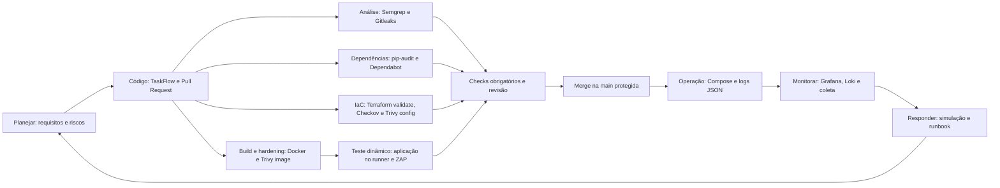

# TaskFlow DevSecOps (estudo individual)

Esteira segura para a aplicação TaskFlow, com GitHub Actions, hardening, SAST, SCA, DAST, infraestrutura como código e observabilidade.

**Estado atual:** linha de base vulnerável importada (ver Origem). As correções e a esteira ainda não foram implementadas.

## Ciclo de desenvolvimento seguro (S-SDLC)



Este diagrama representa a esteira pretendida e será atualizado para refletir o que for implementado.

## Estrutura

```text
.
├── app/                 # Aplicação TaskFlow
├── Dockerfile           # Imagem da aplicação
├── requirements.txt     # Dependências
└── docs/
    └── runbooks/        # Runbook de resposta a incidente
```

Os workflows (`.github/workflows/`), `docker-compose.yml`, `infra/`, `observability/` e `.zap/` serão adicionados conforme cada módulo for implementado.

## Execução local

A fazer, após as correções: instalação, variáveis de ambiente (`.env.example`), execução e testes.

## Workflows e badges

A fazer: descrição de cada workflow, como dispará-lo e badges com as URLs reais.

## Origem e linha de base

A aplicação vem do repositório do professor, <https://github.com/diegobuarquebr/taskflow>:

- `app/app.py` e `Dockerfile`: commit `063e1864ff202535fc3d09122fd0269a0ff49332` (2026-08-06), a versão original e vulnerável.
- `requirements.txt`: commit `da6fa1fc4411db9bca0a2bf65db3957e221eb619` (2026-08-28), com as versões antigas e vulneráveis, instalável hoje e com `gunicorn`.

O repositório de origem não declara licença; nenhuma foi presumida.

O primeiro commit deste repositório é a linha de base e recebe a tag `baseline`. Para reproduzir o "antes" das comparações: `git checkout baseline`.

A linha de base contém segredos didáticos propositais (`SECRET_KEY` e `admin123`). Nenhuma credencial real deve ser versionada.
