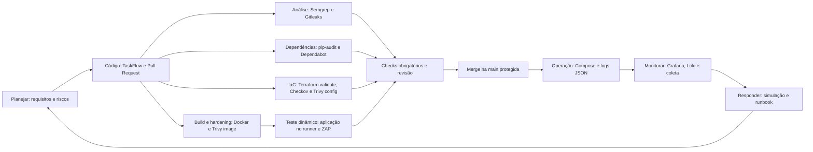
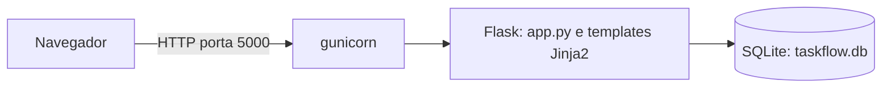
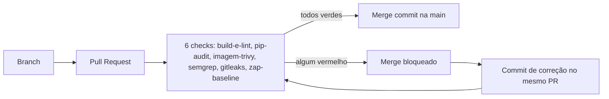

# TaskFlow DevSecOps (estudo individual)

[](https://github.com/pauloed94/taskflow-individual/actions/workflows/ci.yml)
[](https://github.com/pauloed94/taskflow-individual/actions/workflows/sast.yml)
[](https://github.com/pauloed94/taskflow-individual/actions/workflows/sca.yml)
[](https://github.com/pauloed94/taskflow-individual/actions/workflows/dast.yml)

Esteira segura de GitHub Actions para a aplicação **TaskFlow**, uma aplicação Flask que nasceu com vulnerabilidades de propósito. A esteira funciona como *quality gate*: nenhum código entra na `main` sem passar pelo build e lint, pelo hardening da imagem (Trivy), pelo SAST (Semgrep), pelo secret scanning (Gitleaks), pelo SCA (pip-audit) e pelo DAST (ZAP Baseline).

**Estado atual:** módulos 1 a 4 implementados. Infraestrutura como código (módulo 5) e observabilidade (módulo 6) ainda não foram feitos neste repositório.

## Ciclo de desenvolvimento seguro (S-SDLC)



Em que fase entra cada ferramenta, e o que já existe aqui:

| Fase | Ferramenta | Check obrigatório | Estado |
| --- | --- | --- | --- |
| Código | Ruff (lint) | `build-e-lint` | implementado |
| Análise | Semgrep | `semgrep` | implementado |
| Análise | Gitleaks | `gitleaks` | implementado |
| Dependências | pip-audit e Dependabot | `pip-audit` | implementado |
| Build e hardening | Trivy na imagem | `imagem-trivy` | implementado |
| Teste dinâmico | OWASP ZAP Baseline | `zap-baseline` | implementado |
| IaC | Terraform validate, Checkov, Trivy config | — | módulo 5, pendente |
| Operação e resposta | Compose, logs JSON, Grafana, Loki, runbook | — | módulo 6, pendente (o runbook de força bruta existe em `docs/runbooks/`) |

## Arquitetura

A aplicação é um único serviço: o gunicorn serve o Flask, que guarda os dados em um arquivo SQLite. Ainda não há Compose, rede interna nem stack de observabilidade (módulos 5 e 6).



E o caminho de uma alteração até a `main`:



## Estrutura

```text
.
├── app/
│   ├── app.py               # Aplicação Flask
│   └── templates/           # Páginas Jinja2 (autoescape)
├── Dockerfile               # Imagem da aplicação (endurecida)
├── .dockerignore
├── requirements.txt         # Dependências sem CVEs conhecidas
├── .zap/rules.tsv           # Regras do ZAP, com justificativa por regra
├── .github/
│   ├── workflows/           # ci.yml, sast.yml, sca.yml, dast.yml
│   ├── scripts/             # verifica-sinks.sh (conferência extra do DAST)
│   ├── CODEOWNERS
│   └── dependabot.yml
└── docs/
    └── runbooks/            # Runbook de resposta a incidente
```

`docker-compose.yml`, `infra/` e `observability/` serão adicionados nos módulos 5 e 6.

## Execução local

A aplicação **exige** a variável `TASKFLOW_SECRET_KEY`: sem ela, o app se recusa a iniciar. Nenhuma chave é versionada.

```bash
python -m venv .venv
source .venv/bin/activate            # Windows (PowerShell): .venv\Scripts\Activate.ps1
pip install -r requirements.txt

export TASKFLOW_SECRET_KEY="$(python -c 'import secrets; print(secrets.token_hex(32))')"
python app/app.py
```

No PowerShell, defina a variável com `$env:TASKFLOW_SECRET_KEY = "uma-chave-longa-e-aleatoria"`. A aplicação abre em <http://127.0.0.1:5000>. O banco `taskflow.db` é criado na pasta em que o comando é executado (o `.gitignore` já ignora `*.db`). O modo debug fica **desligado**; só liga com `TASKFLOW_DEBUG=1`.

Contas de demonstração: `admin` / `admin123` e `aluno` / `senha123`. Só existem para uso local e para o DAST; no banco ficam gravadas com hash.

Com Docker:

```bash
docker build -t taskflow .
docker run --rm -p 5000:5000 -e TASKFLOW_SECRET_KEY="$(openssl rand -hex 32)" taskflow
```

A imagem roda como usuário sem privilégios (`appuser`) e serve pelo gunicorn.

## Workflows e como disparar cada um

Todos têm os mesmos três gatilhos: `pull_request` (a cada commit de um PR), `push` na `main` (depois de cada merge) e `workflow_dispatch` (manual). Para disparar à mão, abra *Actions*, escolha o workflow e clique em **Run workflow**, ou use o GitHub CLI, por exemplo `gh workflow run ci.yml`.

| Workflow | Arquivo | Jobs (nome do check) | O que faz |
| --- | --- | --- | --- |
| CI | `ci.yml` | `build-e-lint` | instala as dependências e roda o Ruff em `app/` |
| | | `imagem-trivy` | builda a imagem e roda o Trivy como gate para HIGH e CRITICAL |
| SAST | `sast.yml` | `semgrep` | Semgrep com `p/python`, `p/flask` e `p/security-audit`, com `--error` |
| | | `gitleaks` | procura segredos em todo o histórico (`fetch-depth: 0`) |
| SCA | `sca.yml` | `pip-audit` | audita o `requirements.txt` contra a base de vulnerabilidades |
| DAST | `dast.yml` | `zap-baseline` | builda a imagem, sobe o app no runner, espera o `/login` responder e roda o ZAP Baseline; o relatório fica no artefato `zap_scan` |

O **Dependabot** (`.github/dependabot.yml`) verifica uma vez por semana as bibliotecas Python e as actions, e abre PRs quando há versão nova. Os PRs dele passam pelos mesmos checks.

O título de cada execução na aba Actions segue o padrão `NOME · PR aberto · branch` ou `NOME · commit novo no PR · branch` (chave `run-name`), para distinguir as execuções.

## Proteção da `main`

A `main` é protegida por um *ruleset* ativo, sem permissão de burlar: **PR obrigatório**, os **6 checks acima obrigatórios**, bloqueio de *force push* e de exclusão da branch. O `CODEOWNERS` define o dono de todo arquivo. Os PRs são mesclados com **merge commit** (nunca *squash*), para o histórico mostrar os commits de cada episódio.

Decisões de desenho dos workflows:

- **`permissions: contents: read`** em todos os workflows. Só o job do Gitleaks acrescenta `pull-requests: read`, que a action dele usa.
- **Actions de terceiros fixadas por SHA de commit**, com o número da versão em comentário. O Dependabot propõe as atualizações.
- **Sem filtro `paths:` nos checks obrigatórios.** Um check obrigatório que só roda quando certos arquivos mudam deixaria PRs travados esperando um check que nunca dispara. Aqui todo check roda em todo PR.
- **Nenhum gate é suprimido:** não há `continue-on-error`, `nosemgrep` nem `--exit-zero`. O ZAP roda com `fail_action: true`; sem isso, a action nunca reprovaria por alertas.
- **Sem segredos no código:** a chave do app vem de variável de ambiente, e o `dast.yml` gera uma chave aleatória a cada execução.

## Resultados: antes × depois

| Ferramenta | Antes (linha de base) | Depois |
| --- | --- | --- |
| Semgrep | 10 achados | **0** |
| pip-audit | 51 vulnerabilidades em 5 pacotes | **0** |
| Trivy na imagem (HIGH e CRITICAL, com correção disponível) | 225 achados em 2026-11-04 (220 do sistema operacional e 5 de Python; o número varia de dia para dia, porque a base `python:latest` muda) | **0** |
| ZAP Baseline | 5 `FAIL` e 2 `WARN`; o login dava erro 500 sob o gunicorn | **0** `FAIL`, **0** `WARN` (65 regras `PASS`) |
| Gitleaks | sem achados (as regras padrão não reconhecem os segredos didáticos) | sem achados |

### Achados mapeados ao OWASP Top 10:2025

| Categoria | Achado | Quem achou | Correção |
| --- | --- | --- | --- |
| A01 Broken Access Control | Sem token CSRF nos formulários POST | ZAP (10202) | **risco aceito** no laboratório (ver decisões); em produção, usar Flask-WTF |
| A02 Security Misconfiguration | `debug=True`, host `0.0.0.0` e `/debug/info` exposto | Semgrep e conferência manual | debug desligado por padrão e rota removida |
| | Cabeçalhos de segurança ausentes (CSP, anti-clickjacking, `nosniff`, Permissions-Policy, COOP, COEP e CORP) | ZAP (6 regras) | cabeçalhos HTTP no `app.py` |
| | Dockerfile: `python:latest`, root, `ENV` com senha, servidor de desenvolvimento | revisão do Dockerfile e `docker history` | imagem `python:3.12-slim`, usuário sem privilégios, gunicorn |
| | Banco não criado sob o gunicorn (login dava erro 500) | ZAP (alertas de erro) | `init_db()` ao carregar o módulo |
| A03 Software Supply Chain Failures | Dependências antigas, 51 vulnerabilidades | pip-audit e Trivy | versões atualizadas em conjunto |
| A04 Cryptographic Failures | `SECRET_KEY` escrita no código; senhas em texto puro | Semgrep e leitura do código | chave por variável de ambiente; senhas com hash e salt |
| A05 Injection | SQL Injection no login e na busca | Semgrep | consultas parametrizadas |
| | XSS armazenado, no parâmetro `q` e na mensagem de erro do login | Semgrep (o ZAP Baseline não detecta XSS armazenado) | templates Jinja2 com autoescape, sem `\|safe` |
| A09 Logging and Monitoring Failures | Sem logging estruturado nem detecção de ataque | — | módulo 6, pendente |

## Decisões e riscos aceitos

- **`ignore-unfixed` no Trivy.** O gate só conta vulnerabilidades HIGH e CRITICAL que **já têm correção publicada**. As do sistema operacional sem correção não podem ser resolvidas por nós; a exceção fica à vista no workflow e deve ser reavaliada rodando o Trivy sem o filtro de tempos em tempos.
- **Gitleaks sem allowlist.** Os segredos didáticos da linha de base (`SECRET_KEY` e `admin123`) estão no histórico por design, mas o Gitleaks não os acusa, então nenhuma exceção foi criada. Se acusar, a saída é uma allowlist específica por commit, justificada, e nunca desligar a regra nem o job.
- **CSRF aceito como risco.** O ZAP aponta a falta de token CSRF (`10202`), regra marcada `IGNORE` com justificativa em `.zap/rules.tsv`. Está fora do escopo do laboratório.
- **Contas de demonstração.** O `app.py` cria `admin` e `aluno` na primeira execução, com a senha escrita no código (gravada com hash no banco). É um risco aceito, só para demonstração; em produção, não existiria conta com senha conhecida.
- **Conferência extra do DAST.** O ZAP Baseline é passivo e não faz login, então não detecta XSS armazenado. O script `.github/scripts/verifica-sinks.sh` confere o XSS, o parâmetro `q`, a mensagem de erro do login e o `/debug/info`. É um complemento nosso, e o gate do DAST continua sendo o ZAP.
- **Ordem dos episódios.** O SCA vem antes do container (o Trivy também reprova pelas bibliotecas antigas), e as correções de XSS e debug entram no PR do SAST (o Semgrep as acusa). Assim cada PR termina verde com as suas próprias correções.

## Histórico em PRs

Cada PR é um episódio: o gate entra e fica **vermelho**, o merge fica bloqueado, as correções entram como novos commits no **mesmo PR**, e só o verde é mesclado. A `main` nunca recebeu um commit vermelho.

| PR | Episódio | Vermelho | Verde |
| --- | --- | --- | --- |
| [#1](https://github.com/pauloed94/taskflow-individual/pull/1) | CI e CODEOWNERS | — | `build-e-lint` |
| [#2](https://github.com/pauloed94/taskflow-individual/pull/2) | Lint quebrado (demonstração do bloqueio) | `import` sem uso (`F401`) | import removido |
| [#3](https://github.com/pauloed94/taskflow-individual/pull/3) | SCA | `pip-audit`: 51 vulnerabilidades | dependências atualizadas, Dependabot |
| [#4](https://github.com/pauloed94/taskflow-individual/pull/4) | Container | Trivy na imagem original | Dockerfile corrigido |
| [#5](https://github.com/pauloed94/taskflow-individual/pull/5) | SAST e segredos | Semgrep: 10 achados | SQL Injection, `SECRET_KEY`, hash, XSS e debug corrigidos |
| [#6](https://github.com/pauloed94/taskflow-individual/pull/6) | DAST | ZAP: 5 `FAIL` | banco no gunicorn e cabeçalhos de segurança |

## Origem e linha de base

A aplicação vem do repositório do professor, <https://github.com/diegobuarquebr/taskflow>:

- `app/app.py` e `Dockerfile`: commit `063e1864ff202535fc3d09122fd0269a0ff49332` (2026-08-06), a versão original e vulnerável.
- `requirements.txt`: commit `da6fa1fc4411db9bca0a2bf65db3957e221eb619` (2026-08-28), com as versões antigas e vulneráveis, instalável hoje e com `gunicorn`.

O repositório de origem não declara licença; nenhuma foi presumida.

O primeiro commit deste repositório é a linha de base e recebe a tag `baseline`. Para reproduzir o "antes" das comparações: `git checkout baseline`.

A linha de base contém segredos didáticos propositais (`SECRET_KEY` e `admin123`). Nenhuma credencial real deve ser versionada.
